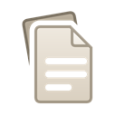
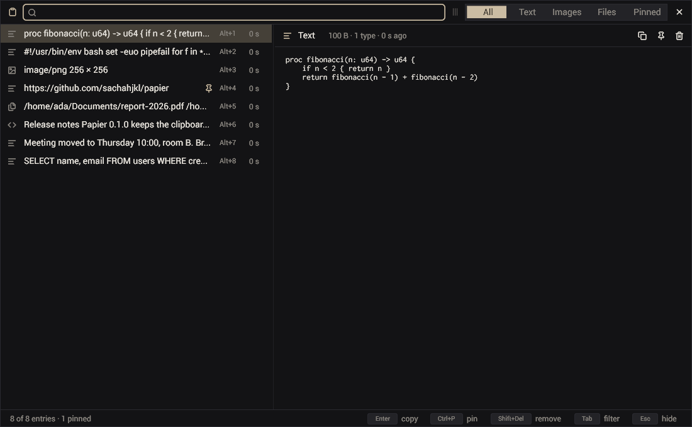
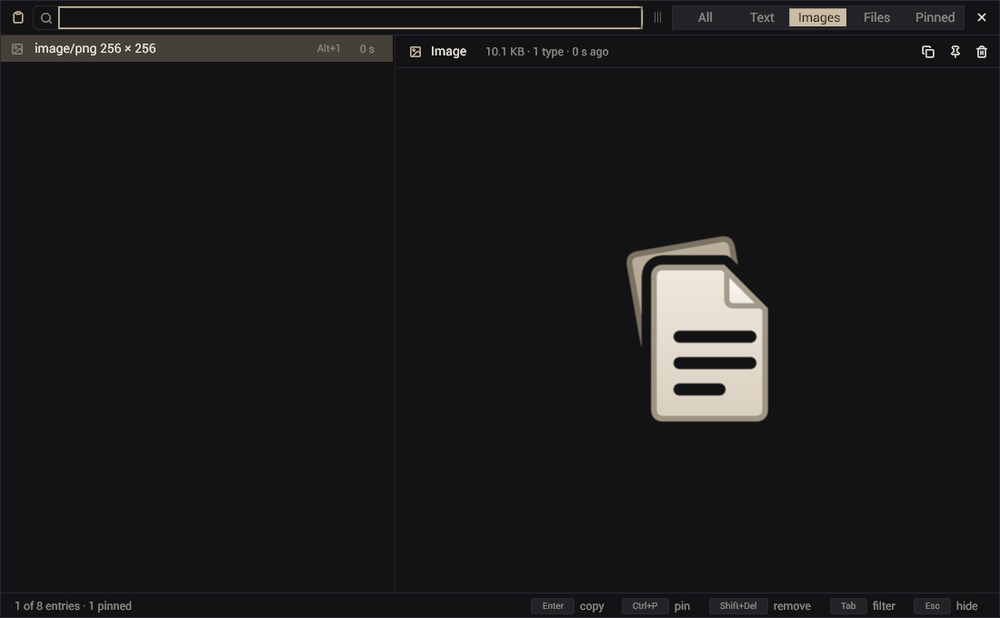
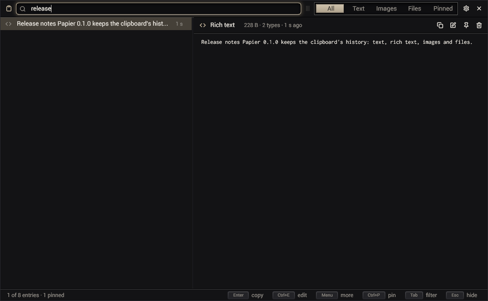

<p align="center"></p>

<h1 align="center">papier</h1>

<p align="center"><b>The clipboard's history for Linux and Windows.</b></p>

<p align="center">
<a href="https://github.com/sachahjkl/papier/actions/workflows/ci.yml"></a>
<a href="https://github.com/sachahjkl/papier/releases/latest"></a>
<a href="https://papier.sacha.house/"></a>
<a href="LICENSE"></a>
</p>

Papier keeps everything you copy, text, rich text, images and files, and gives it back in a keystroke. It is one small
native program, written in [Odin](https://odin-lang.org) on [gui_toolkit](https://github.com/sachahjkl/gui_toolkit). It
lives in the notification area, sleeps at 0 % CPU, and its window comes up in a few milliseconds.



## Features

- **Every kind of copy**: text, the HTML that comes with it, images (PNG, JPEG, WebP, GIF, BMP, SVG), files copied in a
  file manager. Put back, an entry offers every type it had: a rich paste stays rich.
- **Fast to reach**: one process per session; `papier toggle` on a key (Linux) or Win+Shift+V (Windows) shows the window,
  the newest entry selected, the keyboard in the search.
- **Windows**: papier shows the system's clipboard history (the one Win+V shows) with its search, filters and menus.
- **Search as you type**, filters (All, Text, Images, Files, Pinned), Enter to paste into the program you were in
  (Ctrl+V pressed for it; or only copy), Alt+1…9 for the first nine.
- **Pinned entries** stay whatever the limits.
- **An entry's menu** (right click, Menu key): copy, copy as plain text, edit, open, open with any application your
  system knows for its type, show in folder, save as.
- **Edit an entry**: its text in an editor; copy what you edited, or save it in place of the entry.
- **Secrets stay secret**: what a password manager marks (`x-kde-passwordManagerHint`) is never recorded.
- **The clipboard kept**: when the program you copied from quits, the last entry goes back.
- **Light**: 0 % CPU at rest, a list that builds only the rows in view, the same bytes stored once.
- **Configurable**: limits, what to record, colours (its own, or twenty palettes), sizes. A command line for scripts.

| | |
|---|---|
|  |  |
| The Images filter | Search as you type |

## Install

Papier needs a Wayland compositor with data-control (Hyprland, Sway, KDE Plasma 6.2+, river, niri, labwc, Wayfire…),
Vulkan and fontconfig. GNOME has no data-control: papier cannot watch the clipboard there.

**The archive** (Linux x64), from the [releases](https://github.com/sachahjkl/papier/releases/latest):

```sh
tar -xzf papier-*-linux-x64.tar.gz
./papier-*-linux-x64/papier install     # a launcher, ~/.local/bin/papier, the start with the session
```

**Nix**:

```sh
nix run github:sachahjkl/papier               # try it
nix profile add github:sachahjkl/papier       # keep it
```

Then bind a key to `papier toggle`. For Hyprland 0.55:

```lua
hl.on("hyprland.start", function () hl.exec_cmd("papier --hidden") end)
hl.bind("SUPER + V", hl.dsp.exec_cmd("papier toggle"))
```

Sway, older Hyprland, KDE and NixOS: [docs/desktop.md](docs/desktop.md).

## Use

| Key | |
|---|---|
| typing | filter |
| Up, Down, Page Up, Page Down | move |
| Enter, double click | copy back and hide |
| Alt+1 … Alt+9 | copy one of the first nine |
| Tab, Shift+Tab | the next, the previous filter |
| Ctrl+P | pin |
| Shift+Delete | remove |
| Escape | clear the search, then hide |

```sh
papier list             # the newest entries
papier get 42 > x.png   # the bytes of an entry
papier set history.max_entries 5000
papier prefs            # every setting
```

## Documentation

- [Using papier](docs/usage.md): the window, the keys, what is recorded, the command line, the files.
- [Configuration](docs/configuration.md): every preference.
- [On the desktop](docs/desktop.md): requirements, install, Hyprland, Sway, KDE, NixOS.
- [Architecture](docs/architecture.md): the threads, the clipboard protocol, the history on the disk.
- [Development](docs/development.md): building, testing, `papiertool`, releases.

## Build

```sh
git clone --recurse-submodules https://github.com/sachahjkl/papier && cd papier
nix develop
./build.sh release      # build/papier
```

Every step of the project is a command of `tools/papiertool`: `build`, `test`, `check`, `live` (the real program in a
headless sway), `shots`, `logo`, `package`, `ship`, `site`. See [docs/development.md](docs/development.md).

## Licence

MIT, see [LICENSE](LICENSE). Icons: [Lucide](https://lucide.dev), ISC, see
[gui_toolkit's src/lucide/LICENSE.txt](https://github.com/sachahjkl/gui_toolkit/blob/master/src/lucide/LICENSE.txt).
