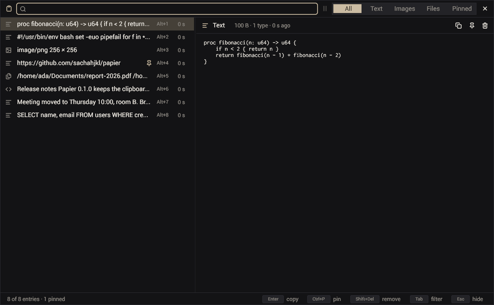

# Using papier

Papier keeps the history of the clipboard. It runs once per session, in the notification area, and its window comes up when
you ask for it.

## Start it

- `papier --hidden` starts papier in the notification area, with no window. Start it with the session (`papier install`
  does it for you, see [desktop.md](desktop.md)).
- `papier` shows the window. When papier does not run yet, this command starts it.
- `papier toggle` shows the window, or hides it when it is shown. Bind it to a key.

A second `papier` never starts a second copy: it sends its command to the running one and ends at once.

## The window



The title bar holds the search and the filters. The list holds the history, newest first. The selected entry is shown in
full beside the list.

| Key | What it does |
|---|---|
| typing | filters the list: each word must be in the entry, case ignored |
| Up, Down | the previous, the next entry |
| Page Up, Page Down | ten entries up, down |
| Ctrl+Home, Ctrl+End | the first, the last entry |
| Tab, Shift+Tab | the next, the previous filter: All, Text, Images, Files, Pinned |
| Enter, a double click | puts the entry back on the clipboard and hides the window |
| Alt+1 … Alt+9 | puts one of the first nine entries back |
| Ctrl+P | pins or unpins the entry |
| Shift+Delete | removes the entry |
| Escape | clears the search; when it is empty, hides the window |

The buttons beside the entry copy, pin and remove it. The splitter between the list and the entry sets the width of the
list. Papier remembers the size of the window, its place (X11 only: on Wayland the compositor places windows) and the
width of the list.

Papier copies an entry back with every type that it had. A copy from a browser that you put back still pastes as rich text
in an editor, and as plain text in a terminal.

## What papier records

| Kind | Types read, best first |
|---|---|
| Text | `text/plain;charset=utf-8`, `UTF8_STRING`, `text/plain`, `STRING`, `TEXT` |
| Rich text | `text/html`, with the text beside it |
| Image | `image/png`, `image/webp`, `image/jpeg`, `image/gif`, `image/bmp`, `image/svg+xml`, any other `image/` type |
| Files | `text/uri-list`, `x-special/gnome-copied-files` |

Papier does not record:

- what a password manager marks as a secret (`x-kde-passwordManagerHint`, KeePassXC and others);
- a copy that offers one of the types of the preference `capture.ignore_mimes`;
- a representation larger than `capture.max_bytes`;
- a text that holds only blanks.

The same copy twice is one entry: the entry moves to the top. When the program that owned the clipboard quits and empties
it, papier puts the last entry back (`clipboard.keep`).

## The command line

| Command | What it does |
|---|---|
| `papier list [count]` | the newest entries: id, kind, age, one line of text |
| `papier get <id> [mime]` | the bytes of an entry on the standard output (its main type, or `mime`) |
| `papier copy <id>` | puts an entry back on the clipboard |
| `papier pin <id>`, `papier unpin <id>` | pins, unpins an entry |
| `papier delete <id>` | removes an entry |
| `papier clear` | removes every entry that is not pinned |
| `papier show`, `papier hide`, `papier toggle` | the window |
| `papier quit` | stops papier |
| `papier prefs` | every preference, its value and what it does |
| `papier set <name> <value>` | changes a preference and saves it; the running papier reads it again |
| `papier install`, `papier uninstall`, `papier status` | the desktop integration ([desktop.md](desktop.md)) |
| `papier version` | the version |

`--pref name=value` sets a preference for one run only.

Example: the last image copied, to a file.

```sh
papier get "$(papier list 100 | awk -F'\t' '$2 ~ /^image/ { print $1; exit }')" > last.png
```

## Where papier keeps its files

| What | Where |
|---|---|
| The history | `$XDG_DATA_HOME/papier` (`~/.local/share/papier`): `index` and `blobs/` |
| The history, with `history.persist` off | `$XDG_RUNTIME_DIR/papier`: gone at the end of the session |
| The preferences | `$XDG_CONFIG_HOME/papier/prefs` (`~/.config/papier/prefs`) |
| The window's size and place | `$XDG_STATE_HOME/papier/window` (`~/.local/state/papier/window`) |

The index is a text file, written atomically. Each blob is the bytes of one type of one copy, named by the hash of its
bytes: the same bytes are stored once.
