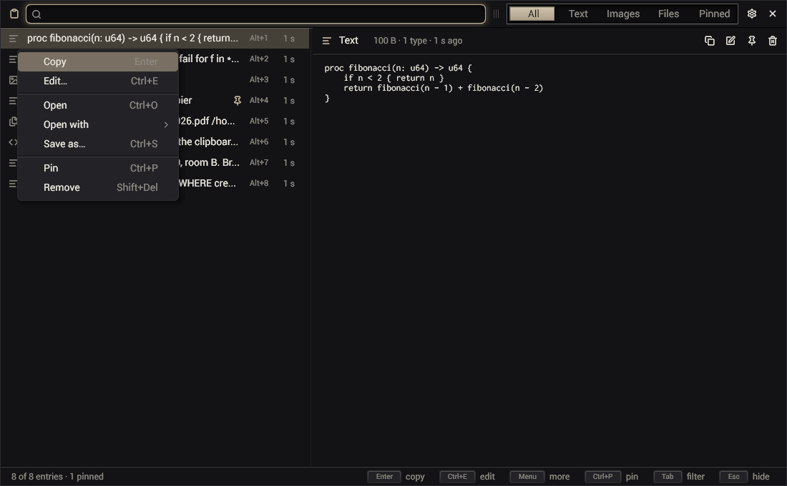
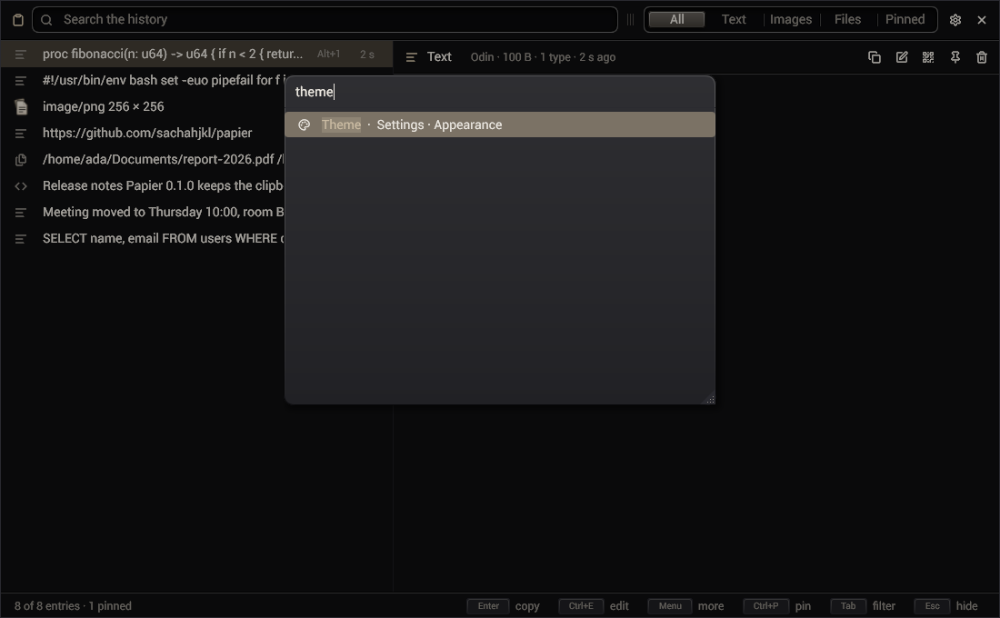
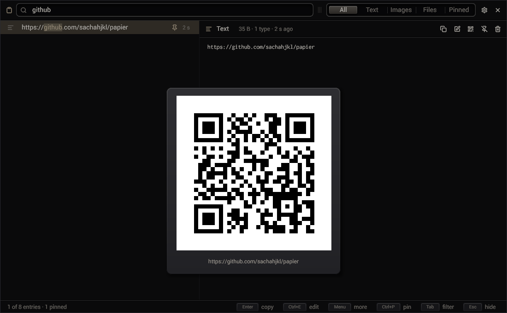
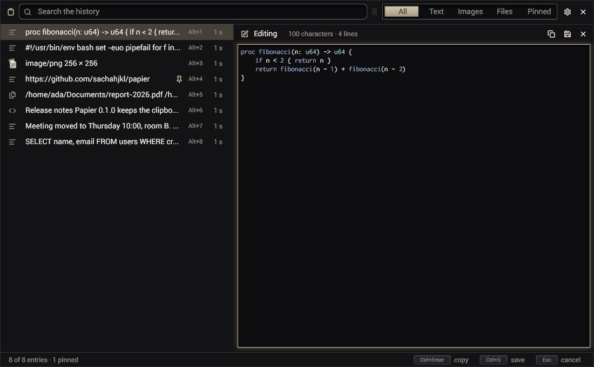

# Using papier

Papier keeps the history of the clipboard. It runs once per session, in the notification area, and its window comes up when
you ask for it.

## Start it

- `papier --hidden` starts papier in the notification area, with no window. Start it with the session (`papier install`
  does it for you, see [desktop.md](desktop.md)).
- `papier` shows the window. When papier does not run yet, this command starts it.
- `papier toggle` shows the window, or hides it when it is shown. Bind it to a key.

A second `papier` never starts a second copy: it sends its command to the running one and ends at once.

## The window


An entry you choose is pasted where you were: papier hides and presses Ctrl+V for the program that has the keyboard again
(`paste.on_select`; `paste.keys` for other keys: a terminal pastes with Ctrl+Shift+V). On Wayland the compositor must
let a program type for another (`zwp_virtual_keyboard_v1`: sway, Hyprland, river, niri, ShojiWM and the other wlroots
compositors; KDE and GNOME do not): without it, the entry is on the clipboard and you paste it yourself.

The title bar holds the search and the filters. The list holds the history, newest first. The selected entry is shown in
full beside the list.

| Key | What it does |
|---|---|
| typing | filters the list: each word must be in the entry, case ignored |
| Up, Down | the previous, the next entry |
| Page Up, Page Down | ten entries up, down |
| Ctrl+Home, Ctrl+End | the first, the last entry |
| Tab, Shift+Tab | the next, the previous filter: All, Text, Images, Files, Pinned |
| Enter, a double click | puts the entry back on the clipboard, hides the window and pastes it into the program you called papier from |
| Alt+1 … Alt+9 | the same with one of the first nine entries |
| Ctrl+P | pins or unpins the entry |
| Shift+Delete | removes the entry |
| Ctrl+E | edits the entry (text and rich text) |
| Ctrl+O | opens the entry |
| Ctrl+S | saves the entry into a file |
| Ctrl+Shift+Q | shows the entry as a QR code, for a phone's camera |
| Ctrl+Shift+T | an image: copies the text in it, as a new entry ([The text in an image](#the-text-in-an-image)) |
| Ctrl+click, Shift+click | marks entries: Enter copies their texts as one, Ctrl+P pins them, Shift+Delete removes them |
| Ctrl+Shift+A | marks every entry shown |
| Ctrl+K, Ctrl+Shift+P | the command palette: every action, searched as you type |
| F1 | the sheet of the keys |
| a right click, Menu, Shift+F10 | the entry's menu |
| a drag of an entry | out of the window, into another program: its text, its picture, its files |
| Escape | clears the marks, then the search; when both are empty, hides the window |

An image fits the preview first: the wheel zooms around the pointer, a drag moves it, a double click shows its pixels
and fits it again, and the bar in its corner zooms out, in, to its pixels or to what fits.

Code (the shell, Python, SQL, Odin, Go, Rust, C, JavaScript, PowerShell, JSON) is shown in colours, its language named
in the entry's header. Papier finds the language from the text itself (gui_toolkit's `syntax.guess`); the edit view keeps
the colours.

An image's row shows a small picture of it, and a copied file's row the system's thumbnail of its first file (a PDF's
first page, a video's frame, a picture), where the system has one.

The buttons beside the entry copy, edit, show as a QR code, pin and remove it. Beside an image, they also copy the
content of a QR code that the picture holds, and the text in the picture. The splitter between the list and the entry sets the width of the
list. Papier remembers the size of the window, its place (X11 only: on Wayland the compositor places windows) and the
width of the list.

## The menu of an entry



| Item | What it does |
|---|---|
| Copy | puts the entry back on the clipboard |
| Copy as plain text | rich text only: puts back its text, without the markup |
| Edit… | opens the edit view |
| Open | opens an address in the browser, a copied file with its program, anything else as a file of its type |
| Open with | the applications that your system knows for the type of the entry; the default is marked |
| Show in folder | a copied file: opens its folder |
| Show as a QR code | text, an address or a path: a QR code in a dialog |
| Copy the QR code's content | an image that holds a QR code: its content, as a new entry |
| Copy the text of the image | an image, when the system can read text: the text in it, as a new entry |
| Save as… | writes the bytes of the entry into a file that you name |
| Pin, Unpin | pins or unpins the entry |
| Remove | removes the entry |

With several entries marked, the menu acts on all of them: copy their texts as one, pin or unpin them, remove them.

## The command palette



Ctrl+K opens every action of papier in a dialog, under their groups: the entry's, the marks', the filters', papier's own
(the settings, the setup, a check for updates, the sheet of the keys, restart, quit), then every setting under its page.
A setting chosen opens the settings on it alone, its page underneath. Type to keep the ones whose words begin as typed;
Enter runs the first. An action that cannot act now is grey. The palette's keys, the menus' and the tooltips' come from
one table (`src/actions.odin`).

## A QR code



To open an entry that is not a file, papier writes it to `$XDG_RUNTIME_DIR/papier/open/papier-<id>.<extension>`: a
program needs a file. The session's runtime folder is yours alone and empty at the next session.

## A QR code in an image

When the selected image holds a QR code (a screenshot of a code, a ticket, a page with a link), papier reads it when it
shows the picture. A QR code icon then comes beside the entry, and the entry's menu and the palette offer "Copy the QR
code's content". The content becomes a new entry, on the clipboard (pasted and the window hidden as for any copy). A code
whose content is not text is not offered.

## The text in an image

"Copy the text of the image" (Ctrl+Shift+T, the icon beside an image, the entry's menu, the palette) reads the text in the
picture with the system's text recognition (OCR) and copies it as a new entry. A reading takes a second or more: the
status bar says "Reading the text of the image…" until it ends, then how many lines it copied. A table keeps its rows,
its cells parted by tabs.

The action is there only when the system can read text:

- **Linux**: Tesseract 5 and its data for each language to read: `tesseract-ocr` on Debian and Ubuntu (English included,
  `tesseract-ocr-fra` and others for more), `tesseract` and `tesseract-langpack-*` on Fedora, `tesseract` and
  `tesseract-data-*` on Arch. The papier of the Nix flake carries Tesseract and its languages.
- **Windows**: the "Optical character recognition" part of a language pack: Settings → Time & language → Language & region
  → a language → Language options.

Papier reads with the user's languages (`LANG`, and English) where they are installed.

## The edit view



Ctrl+E, or the pencil beside the entry, puts the text of the entry in an editor, in place of the entry.

| Key | What it does |
|---|---|
| Ctrl+Enter | copies the text: a new entry at the top, on the clipboard |
| Ctrl+S | saves the text in place of the entry: the entry keeps its place and its pin |
| Escape | leaves the edit view; nothing is kept |

Rich text is edited as its text, and saved as text. Selecting another entry leaves the edit view.

## Types

Papier copies an entry back with every type that it had. A copy from a browser that you put back still pastes as rich text
in an editor, and as plain text in a terminal.

## What papier records

| Kind | Types read, best first |
|---|---|
| Text | `text/plain;charset=utf-8`, `UTF8_STRING`, `text/plain`, `STRING`, `TEXT` |
| Rich text | `text/html`, with the text beside it |
| Image | `image/png`, `image/webp`, `image/jpeg`, `image/gif`, `image/bmp`, `image/svg+xml`, any other `image/` type |
| Files | `text/uri-list`, `x-special/gnome-copied-files` |

Papier does not record:

- what a password manager marks as a secret (`x-kde-passwordManagerHint`, KeePassXC and others);
- a copy that offers one of the types of the preference `capture.ignore_mimes`;
- a representation larger than `capture.size_limit`;
- a text that holds only blanks.

The same copy twice is one entry: the entry moves to the top. When the program that owned the clipboard quits and empties
it, papier puts the last entry back (`clipboard.keep`).

## The command line

| Command | What it does |
|---|---|
| `papier list [count]` | the newest entries: id, kind, age, one line of text |
| `papier get <id> [mime]` | the bytes of an entry on the standard output (its main type, or `mime`) |
| `papier copy <id>` | puts an entry back on the clipboard |
| `papier pin <id>`, `papier unpin <id>` | pins, unpins an entry |
| `papier delete <id>` | removes an entry |
| `papier clear` | removes every entry that is not pinned |
| `papier show`, `papier hide`, `papier toggle` | the window |
| `papier quit` | stops papier |
| `papier prefs` | every preference, its value and what it does |
| `papier set <name> <value>` | changes a preference and saves it; the running papier reads it again |
| `papier install`, `papier uninstall`, `papier status` | the desktop integration ([desktop.md](desktop.md)) |
| `papier version` | the version |

`--pref name=value` sets a preference for one run only.

Example: the last image copied, to a file.

```sh
papier get "$(papier list 100 | awk -F'\t' '$2 ~ /^image/ { print $1; exit }')" > last.png
```

## Where papier keeps its files

| What | Where |
|---|---|
| The history | `$XDG_DATA_HOME/papier` (`~/.local/share/papier`): `history.db` |
| The history, with `history.persist` off | `$XDG_RUNTIME_DIR/papier`: gone at the end of the session |
| The preferences | `$XDG_CONFIG_HOME/papier/prefs` (`~/.config/papier/prefs`) |
| The window's size and place | `$XDG_STATE_HOME/papier/window` (`~/.local/state/papier/window`) |

`history.db` is a SQLite database: `sqlite3 ~/.local/share/papier/history.db` reads it. The bytes of each type of each
copy are stored once, by their hash. The search reads the whole text of each copy.
